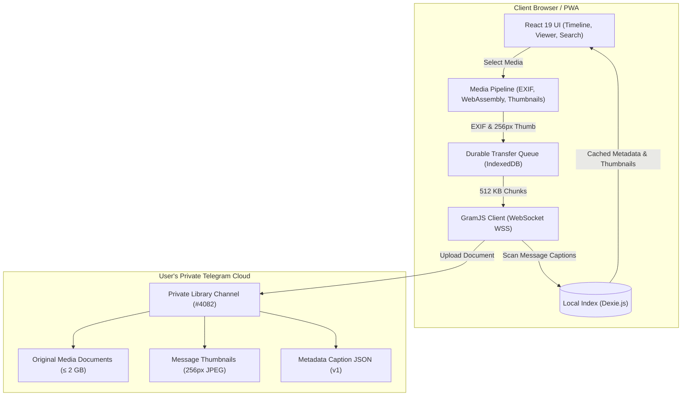

<div align="center">


# Telegram Photos

### A Google Photos clone powered entirely by your own Telegram account.

**Zero proprietary storage servers. Originals stored as documents in Telegram. Disposable, rebuildable local index.**

[](https://vitejs.dev/)
[](https://react.dev/)
[](https://www.typescriptlang.org/)
[](https://github.com/gram-js/gramjs)
[](https://dexie.org/)

</div>

---

## Overview

Telegram Photos is a photo and video library application with a Google Photos-style experience (timeline, albums, search, favorites, trash, EXIF inspector) where the user's personal Telegram account is the storage backend.

- **Original Quality (Documents):** Photos and videos are uploaded as uncompressed Telegram documents (up to 2,000,000,000 bytes / 2 GB per file), bypassing Telegram's aggressive photo re-compression.
- **Embedded Caption Metadata:** Each message embeds a compact JSON schema (`v:1`) containing capture timestamp, dimensions, SHA-256 hash, original filename, and album tags.
- **Disposable & Rebuildable Index:** The local database (Dexie / IndexedDB) is an ephemeral cache. If a device is lost or browser storage is wiped, the entire library can be reconstructed in minutes by scanning the private channel's message captions.
- **Client-Side MTProto:** Runs 100% in the browser over WebSockets (`wss://<dc>.web.telegram.org/apiws`). No middleman server ever touches your credentials or media.
- **Durable Queue & Flood-Wait Resilience:** Chunked uploads (512 KB parts) with automatic exponential backoff on Telegram `FLOOD_WAIT_X` rate limits.

---

## Architecture



---

## Features (Phase 1 Implemented)

- [x] **Telegram Authentication:** Supports Phone + Verification Code, 2FA Cloud Password, and QR Code login flows.
- [x] **Channel Auto-Provisioning:** Creates and tracks a dedicated private channel for your photo library.
- [x] **Client-Side Media Pipeline:**
  - Extracts EXIF (date taken, camera make/model, focal length, ISO, GPS coordinates).
  - Client-side 256px JPEG thumbnail generation for instantaneous timeline rendering.
  - Video poster frame generation and duration detection.
  - SHA-256 hash calculation for content-based deduplication.
- [x] **Durable Transfer Queue:**
  - Chunked 512 KB uploads with live progress and transfer speed calculation.
  - Automatic `FLOOD_WAIT` detection and cooldown countdown timer.
  - Hard rejection guard for files exceeding 2,000,000,000 bytes (2 GB).
- [x] **Timeline Grid:**
  - Clustered by date (Today, Yesterday, Month).
  - Video duration badges and HDR indicators.
  - One-click favorite and trash toggles.
- [x] **Full-Screen Media Viewer:**
  - Full EXIF inspector (camera, lens, ISO, GPS map coordinates).
  - Telegram document invariants inspector (Message ID, Channel ID, Caption JSON v1).
- [x] **One-Click Index Rebuild:** Scans raw Telegram channel history and restores local index with zero data loss.
- [x] **Storage Insights:** Total storage usage breakdown by media type and timeline.

---

## Getting Started

### 1. Prerequisites
- Node.js >= 20
- npm >= 10

### 2. Development

```bash
# Clone the repository
git clone https://github.com/your-username/telegram-drive.git
cd telegram-drive

# Install dependencies
npm install

# Start development server
npm run dev
```

Open [http://localhost:3000](http://localhost:3000) in your browser.

### 3. Production Build

```bash
npm run build
npm run preview
```

---

## Clean-Room Notice

This project was built clean-room from the ground up in TypeScript/React. While inspired by the storage patterns of `caamer20/Telegram-Drive`, zero source code was copied due to its proprietary licensing.
